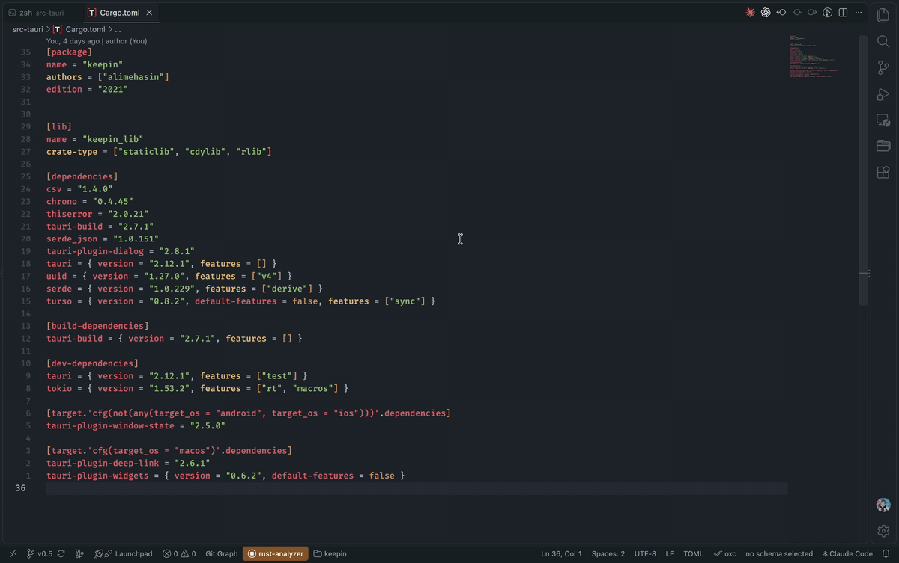

# cargo-cratesup

[](https://crates.io/crates/cargo-cratesup)
[](LICENSE)

Find outdated dependencies in your `Cargo.toml` and update them with one command.



## Installation

```bash
cargo install cargo-cratesup
```

## Usage

Run it in your project's directory, next to `Cargo.toml`:

```bash
# List the dependencies that have a newer version
cargo cratesup

# Update Cargo.toml to the latest versions
cargo cratesup --update   # or -u
```

Without `--update`, nothing is changed.

`--update` moves to the latest release, including new major versions that may have breaking changes, so review the diff and run `cargo build` afterwards.

## Features

- **Fast**: crates are looked up in parallel through the crates.io sparse index, the same one Cargo uses
- **Every section**: checks `[dependencies]`, `[dev-dependencies]`, `[build-dependencies]` and target-specific tables
- **Minimal edits**: only the version numbers are rewritten, and the rest of `Cargo.toml` is left as it is
- **Sensible versions**: yanked releases are ignored, and pre-releases are only suggested if you already use one
- Path and git dependencies without a version are skipped

## Contributing

Bug reports and pull requests are welcome on [GitHub](https://github.com/alimehasin/cargo-cratesup/issues).

## License

[MIT](LICENSE)
